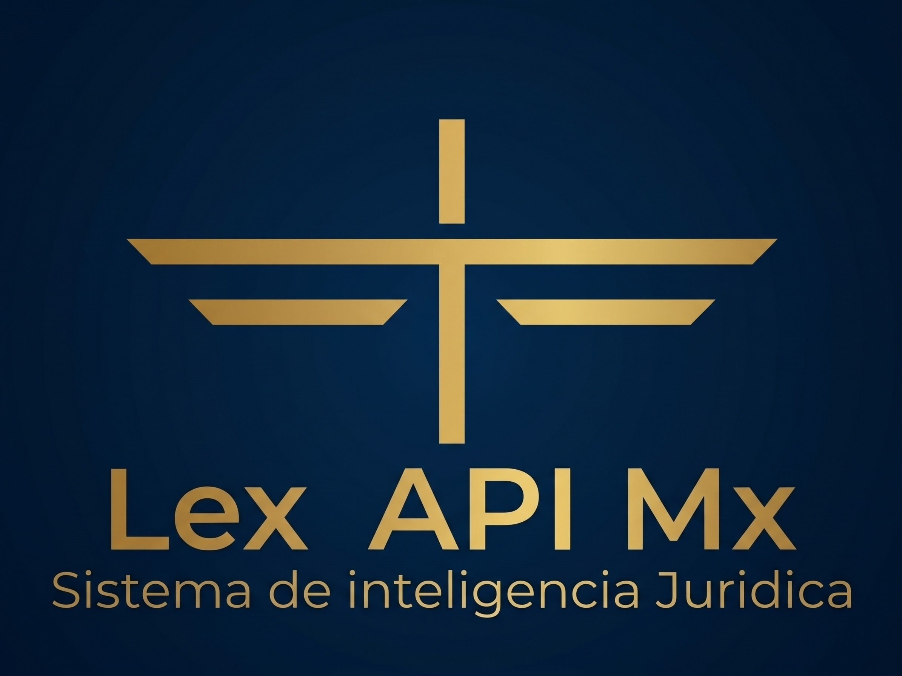

<p align="center">
  
</p>

# Lex API MX

**La legislación federal mexicana vigente, como API.** Cada artículo con su
fuente oficial, su checksum SHA-256 y su periodo de vigencia, listo para que tu
aplicación o tu agente de IA cite la ley sin construir ni mantener un corpus.

Sistema de inteligencia jurídica · [lexapi.mx](https://lexapi.mx) ·
[Documentación de la API](https://api.lexapi.mx/docs) ·
[Crear cuenta gratis](https://lexapi.mx/#cuenta)

## Para quién

Equipos que necesitan citar la ley con precisión dentro de software: agentes y
asistentes de IA, legaltech, nómina, facturación, contabilidad y fintech. Lex API
MX no es un chatbot ni emite opiniones: devuelve texto vigente, estructura,
fuente, checksum y vigencia, y tu sistema decide qué hacer con ellos.

## Cobertura

| | |
|---|---|
| Ordenamientos federales | **123**: Constitución, 9 códigos, 69 leyes y 44 reglamentos |
| Artículos vigentes | **29,547** |
| Disposiciones (artículos, fracciones, incisos, capítulos…) | **77,558** |
| Fuente oficial y checksum por disposición | 100 % |
| Fuentes | Cámara de Diputados, Diario Oficial de la Federación, STPS y TJA CDMX |

La lista completa de normas está en [`docs/CATALOGO.md`](docs/CATALOGO.md). La
cobertura es federal y prospectiva: cada norma se conserva desde su fecha de
incorporación; una fecha anterior responde `outside_coverage` y nunca se
presenta texto vigente como histórico.

## Empieza en cinco minutos

**1. Crea tu cuenta** en [lexapi.mx/#cuenta](https://lexapi.mx/#cuenta): te
enviamos un enlace al correo, sin contraseña ni tarjeta. El plan gratuito trae
500 créditos al mes y una clave de API que se muestra una sola vez.

**2. Conecta tu agente (MCP).** Claude Code:

```bash
claude mcp add lex-api-mx --env LEX_API_MX_KEY=tu_clave -- uvx lex-api-mx-mcp
```

Claude Desktop o Cursor (`claude_desktop_config.json`, `.cursor/mcp.json`):

```json
{
  "mcpServers": {
    "lex-api-mx": {
      "command": "uvx",
      "args": ["lex-api-mx-mcp"],
      "env": { "LEX_API_MX_KEY": "tu_clave" }
    }
  }
}
```

Tu agente obtiene tres herramientas: `resolve_legal_citation`,
`search_mexican_law` y `get_norm_structure`. Guía completa:
[`docs/MCP_QUICKSTART.md`](docs/MCP_QUICKSTART.md).

**3. O llama a la API directamente.**

```bash
curl "https://api.lexapi.mx/api/v1/articulos/search?q=rescisi%C3%B3n%20sin%20responsabilidad&norma=lft" \
  -H "X-API-Key: tu_clave"
```

```python
# pip install lex-api-mx-client
from lex_api_mx import LexApiClient

with LexApiClient(base_url="https://api.lexapi.mx", api_key="tu_clave") as client:
    package = client.resolve(query="Artículo 47 LFT", norm="lft")
```

Guía: [`docs/QUICKSTART.md`](docs/QUICKSTART.md) · Referencia:
[`docs/API_SPEC.md`](docs/API_SPEC.md) · Contrato del paquete normativo:
[`docs/NORMATIVE_PACKAGE_CONTRACT.md`](docs/NORMATIVE_PACKAGE_CONTRACT.md).

## Operaciones y créditos

| Operación | Créditos |
|---|---|
| Resolver una cita o consulta (`POST /resolve`) | 1 |
| Buscar artículos, obtener un artículo, su historial, la estructura de una norma | 1 |
| Mapa normativo: qué leyes aplican a un caso (`POST /map`, planes de la API) | 2 |

Solo se cobran respuestas exitosas; un reintento con la misma `Idempotency-Key`
y la misma petición no se cobra dos veces. El texto completo de una norma
(`include_text`) y el mapa normativo están incluidos en los planes de la API.

## Planes

| Plan | Incluye | Precio (MXN, IVA incluido) |
|---|---|---|
| Gratis | 500 créditos al mes, API y servidor MCP, sin tarjeta | $0 |
| API Inicial | 10,000 créditos al mes, mapa normativo y texto completo de normas | $499 al mes o $4,990 al año |
| API Profesional | 50,000 créditos al mes, mapa normativo y texto completo de normas | $1,499 al mes o $14,990 al año |
| Recarga | 1,000 créditos que no caducan | $100 |

Contratación y recargas en [lexapi.mx/#cuenta](https://lexapi.mx/#cuenta), con
factura CFDI 4.0. ¿Volumen, condiciones o SLA a la medida? Escríbenos a
[admin@lexapi.mx](mailto:admin@lexapi.mx).

## Qué hay en este repositorio

- [`packages/lex-api-client`](packages/lex-api-client): SDK de Python
  ([`lex-api-mx-client`](https://pypi.org/project/lex-api-mx-client/) en PyPI).
- [`packages/lex-mcp-server`](packages/lex-mcp-server): servidor MCP
  ([`lex-api-mx-mcp`](https://pypi.org/project/lex-api-mx-mcp/) en PyPI y en el
  [MCP Registry](https://registry.modelcontextprotocol.io) como
  `io.github.Julio-Patron/lex-api-mx`).
- [`docs/`](docs): guías, catálogo de normas, referencia de la API, contrato
  OpenAPI y política de uso de IA.
- [`examples/`](examples): ejemplos de integración.

El SDK y el servidor MCP son adaptadores delgados bajo licencia MIT (ver cada
paquete). El servicio, el corpus normativo, la plataforma y la marca Lex API MX
son propiedad de Lex API MX y no forman parte de este repositorio.

## Soporte

- Dudas e incidencias del SDK o del MCP:
  [Issues](https://github.com/Julio-Patron/lexapi-mx/issues).
- Cuenta, facturación o cobertura: [admin@lexapi.mx](mailto:admin@lexapi.mx).
- [Aviso de Privacidad](https://lexapi.mx/privacidad) ·
  [Términos y Condiciones](https://lexapi.mx/terminos)
